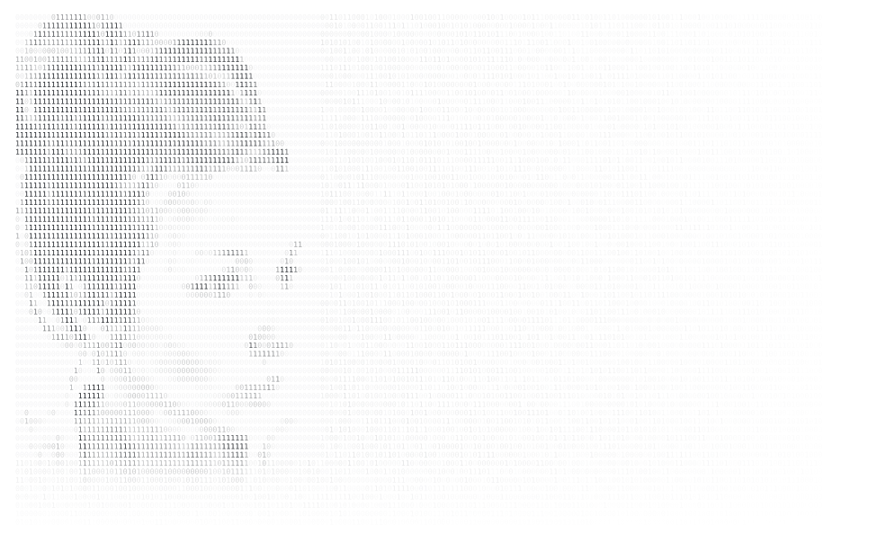

<!-- Generated by build_card.py from profile.toml: edit that file, not this one. -->

  <picture><source media="(prefers-color-scheme: dark)" srcset="header-dark.svg"></picture> 
  <picture><source media="(prefers-color-scheme: dark)" srcset="panel-dark.svg"></picture>

  <a href="https://lintel-libraries.vercel.app"><picture><source media="(prefers-color-scheme: dark)" srcset="links/libraries-dark.svg"></picture></a>
  <a href="stubs/launcher.md"><picture><source media="(prefers-color-scheme: dark)" srcset="links/launcher-dark.svg"></picture></a>
  <a href="stubs/discovery.md"><picture><source media="(prefers-color-scheme: dark)" srcset="links/discovery-dark.svg"></picture></a>
  <a href="https://Perplexity.ai/Discover"><picture><source media="(prefers-color-scheme: dark)" srcset="links/random-dark.svg"></picture></a>

