<!-- Generated by build_card.py from profile.toml: edit that file, not this one. -->

  <picture><source media="(prefers-color-scheme: dark)" srcset="panel-dark.svg"></picture>

  <a href="https://lintelligences.github.io/lintelligences/launcher.html" target="_blank" rel="noopener noreferrer"><picture><source media="(prefers-color-scheme: dark)" srcset="links/behavior-dark.svg"></picture></a>
  <a href="https://lintelligences.github.io/lintelligences/discovery.html" target="_blank" rel="noopener noreferrer"><picture><source media="(prefers-color-scheme: dark)" srcset="links/briefings-dark.svg"></picture></a>
  <a href="https://lintelligences.github.io/lintelligences/" target="_blank" rel="noopener noreferrer"><picture><source media="(prefers-color-scheme: dark)" srcset="links/observatory-dark.svg"></picture></a>
  <a href="https://lintel-libraries.vercel.app" target="_blank" rel="noopener noreferrer"><picture><source media="(prefers-color-scheme: dark)" srcset="links/libraries-dark.svg"></picture></a>

